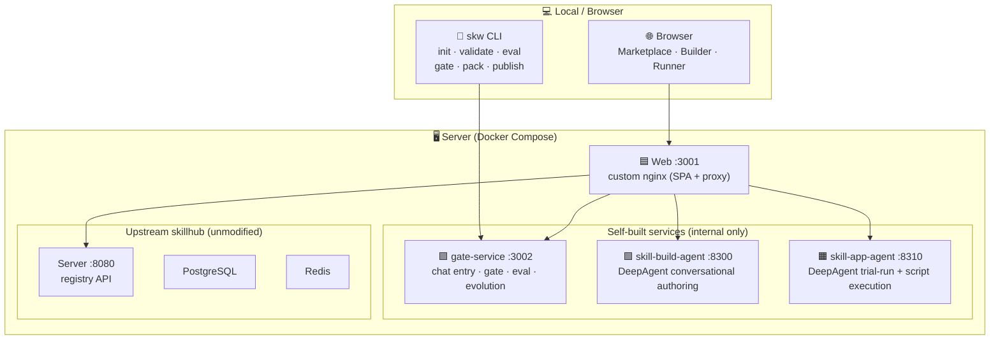

<p align="center">
  <a href="README.md">简体中文</a> · <b>English</b>
</p>

<div align="center">

# 🧠 Skill Hub

### Full-lifecycle platform for AI agent skills — author, validate, benchmark, evolve, publish, install, trial-run

[](https://github.com/wanshoulu/Skill-Hub/actions/workflows/ci.yml)
[](https://github.com/iflytek/skillhub)
[](LICENSE)
[](https://docs.docker.com/compose/)
[](https://vitejs.dev/)

</div>

---

**Skill Hub** makes agent skills *real*: not just a marketplace, but a working chain that takes a skill from a conversation to a validated, benchmarked, versioned artifact that an agent actually executes.

### Core features

| | Feature |
|:---:|---|
| 🛠️ | **Conversational authoring** — a DeepAgent walks you through requirements and drafts the skill (SKILL.md + scripts) |
| 🔍 | **Static gate checks** — five instant checks (structure / security / dependencies / script executability / prompt compliance), zero LLM cost |
| 🧪 | **Real LLM evaluation** — auto-generated test cases, multi-dimension scoring (correctness / efficiency / robustness) with a full evidence chain |
| 🔄 | **Multi-round reflective evolution** — auto-iterates on eval results (reflect → rewrite → re-eval), digest-level caching avoids re-runs |
| 📦 | **One-click publish** — `skw pack` + `skw publish` to the registry, versioned and namespace-isolated |
| 🤖 | **Real installation** — "Install to Agent" on the marketplace registers the skill into an agent's skill library (not just a copied prompt) |
| 💬 | **SSE trial runs** — skills load on demand, scripts actually execute, with a live execution timeline |

### Architecture (single-host Docker Compose)



### Quick start

```bash
# Full stack
cd deploy && docker compose --env-file .env.release up -d

# Web UI on :3001 — bootstrap admin from .env.release (BOOTSTRAP_ADMIN_*)
```

The `skw` CLI covers the offline loop: `skw init → skw validate → skw eval → skw gate → skw pack → skw publish`.

### Safety model

Privileged endpoints (`/gate-api`, `/build-api`, `/app-api` — build, install, script execution) are protected by a separate `GATE_TOKEN` (Bearer), independent of the web login session. Internal services are never exposed directly.

### Credits & License

Registry upstream: [iflytek/skillhub](https://github.com/iflytek/skillhub) (Apache-2.0), used unmodified. The gate service, trial-run agents, and React workbench additions in this repo are Apache-2.0. Full Chinese documentation: [README.md](README.md).
