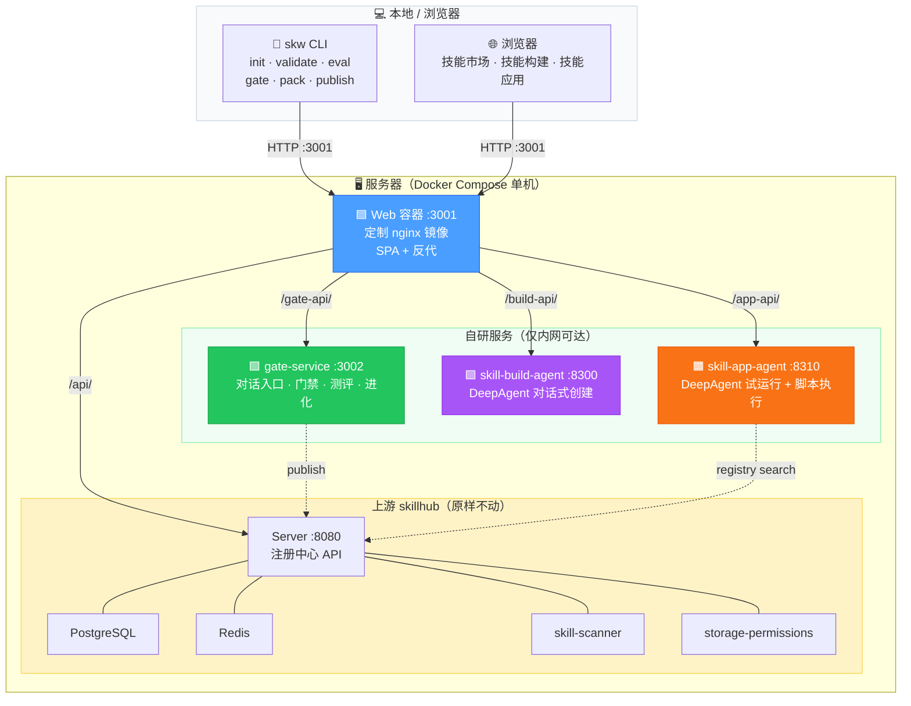
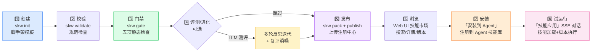
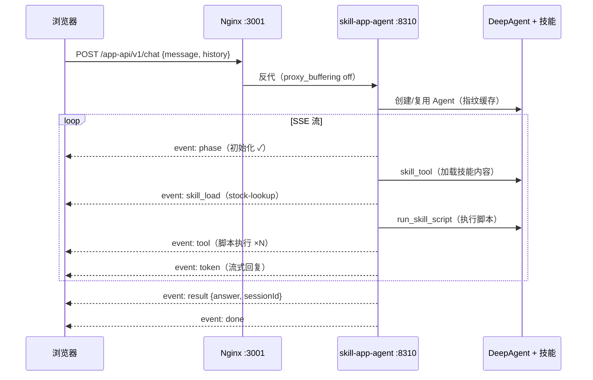

<div align="center">

# 🧠 Skill Hub

### Agent 技能全生命周期平台 — 从创建到试运行，端到端打通

[](https://github.com/iflytek/skillhub)
[](LICENSE)
[](https://docs.docker.com/compose/)
[](https://vitejs.dev/)
[-339933)](https://www.python.org/)

</div>

---

> **Skill Hub** 在 [iflytek/skillhub](https://github.com/iflytek/skillhub) 注册中心基础上，自研补齐了技能**创建 → 检查 → 测评 → 进化 → 发布 → 安装 → 对话试运行**的完整链路，让 Agent 技能不再只是"注册表里一行记录"，而是**真实可装、真实可跑**。

---

## 📑 目录

- [✨ 核心特性](#-核心特性)
- [🏛️ 总体架构](#️-总体架构)
- [📦 目录结构](#-目录结构)
- [🚀 快速开始](#-快速开始)
- [🔄 端到端流程](#-端到端流程)
- [🧩 核心组件](#-核心组件)
- [🔧 架构设计要点](#-架构设计要点)
- [📡 API 概览](#-api-概览)
- [🎨 相对上游的定制](#-相对上游的定制)
- [📚 文档](#-文档)

---

## ✨ 核心特性

| 特性 | 说明 |
|:---:|---|
| 🛠️ | **对话式创建** — DeepAgent 引导用户描述需求，自动生成技能草稿（SKILL.md + 脚本） |
| 🔍 | **静态门禁检查** — 五项秒级检查（结构 / 安全 / 依赖 / 脚本可执行 / 提示词合规），无 LLM 开销 |
| 🧪 | **LLM 真实测评** — 自动生成测试用例，多维度评分（正确性 / 效率 / 鲁棒性），附完整证据链 |
| 🔄 | **多轮反思进化** — 基于测评结果自动迭代优化（反思 → 重写 → 复评消噪），digest 级缓存避免重跑 |
| 📦 | **一键发布** — `skw pack` 打包 + `skw publish` REST 上传到注册中心，版本化 + 命名空间隔离 |
| 🤖 | **真实安装到 Agent** — 市场详情页「安装到 Agent」按钮 = 注册到 Agent 技能库，不是复制提示词 |
| 💬 | **SSE 对话试运行** — 技能按需加载、脚本真实执行、过程时间线实时呈现（加载技能 → 执行脚本 → 回复） |

---

## 🏛️ 总体架构



> **流量收口**：浏览器与 CLI 统一走 `:3001`（nginx 反代 `/gate-api/`、`/build-api/`、`/app-api/`），3002/8300/8310 仅 Docker 网络内可达，对外只需开放 **3001** 一个端口。

---

## 📦 目录结构

```
skill-hub/
├── skillhub-src/            📦 上游 iflytek/skillhub v0.2.26 源码 + web 定制
├── workbench/               🔧 自研 CLI「skw」（Node.js）
│   ├── bin/skw.js           入口
│   ├── src/                 config / skill / pack / publish / eval / providers
│   └── templates/default/   init 脚手架模板
├── gate-service/            🟩 技能构建门禁服务（Node，:3002）
│   └── src/                 auth / orchestrator / llm / judge / stages / pack / evolve
├── skill-app-agent/         🟧 技能应用试运行服务（Python，:8310）
│   ├── app/                 main / agent_factory / registry_client / skill_installer / tools / rails / sse
│   └── probe.py             三轮对话冒烟探针
├── deploy/                  🚀 部署编排
│   ├── compose.release.yml  上游 6 服务编排（web 已固化定制镜像与反代上游）
│   ├── gate-compose.yml     gate / skill-build-agent / skill-app-agent 三个新增服务
│   ├── skill-build-agent.Dockerfile
│   ├── web-custom/          web 定制镜像（Dockerfile + nginx 模板 + overlay）
│   ├── seed/skills-custom/  预置种子技能
│   ├── .env.release.example 上游完整配置模板
│   └── .env.gate.example    gate / agent 服务的 LLM 与令牌配置模板
├── docs/                     📚 设计文档
│   ├── design.md            总体方案（选型、架构、部署、里程碑）
│   └── gate-design.md       G 系列功能设计（含 API 契约）
└── README.md
```

---

## 🚀 快速开始

### 1️⃣ 准备配置

```bash
cd deploy

# 上游 6 服务配置（端口、管理员、cookie 签名密钥等）
cp .env.release.example .env.release

# gate / agent 服务配置（GATE_TOKEN、LLM 模型源、AUTO_INSTALL_SKILLS）
cp .env.gate.example .env.gate

# ⚠️ 编辑两个 .env 文件：把 TODO 值全部替换为真实值
#    .env.release 含密钥，不要提交到 git
```

### 2️⃣ 构建定制镜像

```bash
# web 定制镜像（需先在 skillhub-src/web 下 npm ci && npm run build 得到 dist）
docker build -t skillhub-web-custom:v0.2.26.3 -f deploy/web-custom/web.custom.Dockerfile <web-build-context>

# 三个自研服务
docker build -t gate-service:0.1.0        -f gate-service/Dockerfile       gate-service
docker build -t skill-build-agent:0.1.0   -f deploy/skill-build-agent.Dockerfile .
docker build -t skill-app-agent:0.1.0     -f skill-app-agent/Dockerfile    skill-app-agent
```

### 3️⃣ 启动服务

```bash
cd deploy

# 上游 6 服务
docker compose --env-file .env.release -f compose.release.yml up -d

# 三个新增服务（加入 skillhub 网络）
docker compose --env-file .env.gate -f gate-compose.yml up -d
```

> ⚠️ `compose.release.yml` 的 web 段已固化定制镜像与 `GATE_API_UPSTREAM` / `BUILD_AGENT_UPSTREAM` / `APP_API_UPSTREAM` 环境变量。不要用无 overlay 的旧编排覆盖 web，否则定制反代会整体回退到原生镜像。

### 4️⃣ 访问与令牌

| 项目 | 说明 |
|---|---|
| **Web UI** | `http://<SERVER_IP>:3001` |
| **管理员账号** | 在 `.env.release` 的 `BOOTSTRAP_ADMIN_*` 中设置 |
| **特权 API 令牌** | 在 `.env.gate` 的 `GATE_TOKEN` 中设置；前端在「技能构建」或「技能应用」页右上角 **「配置令牌」** 对话框填入同一个值（存 localStorage） |

> 💡 **为什么要令牌？** `/gate-api`、`/build-api`、`/app-api` 能在服务器上执行构建、安装技能、运行技能脚本等特权操作，必须验证操作者是管理员。令牌独立于平台登录态，仅存浏览器 localStorage，每个浏览器配一次。

---

## 🔄 端到端流程



<details>
<summary>📋 流程详解</summary>

- **CLI 主循环**：`skw init → validate → eval → pack → publish`，发布走官方 `POST /api/cli/v1/skills/{namespace}/publish`
- **安装即注册**：市场详情页的「安装到 Agent」与「技能应用」页的注册中心安装共用同一服务端 API（`/app-api/v1/skills/install`），安装即注册到 Agent 的技能库；重复安装返回 409（前端视为已安装）
- **试运行事件流**（SSE）：



</details>

---

## 🧩 核心组件

| 组件 | 端口 | 技术栈 | 职责 |
|---|:---:|---|---|
| **skw CLI** | — | Node.js | `init` 脚手架 → `validate` 规范校验 → `eval` LLM 评测 → `gate` 门禁检查 → `pack` 打包 → `publish` REST 发布；纯客户端无状态 |
| **gate-service** | 3002 | Node.js | 统一对话入口（SSE 意图路由）；basic 五项静态检查（秒级无 LLM）；runtime 真实 LLM 用例测评；多轮反思进化 + 复评消噪；证据链以 `content_digest = sha256(zip)` 绑定 |
| **skill-build-agent** | 8300 | Python (OpenJiuWen) | DeepAgent 对话式创建技能草稿（`/data/drafts/`） |
| **skill-app-agent** | 8310 | Python (OpenJiuWen) | 技能应用试运行：注册中心技能真实安装 → 按需加载 → `run_skill_script` 子进程真实执行（60s 超时、输出截断、防路径穿越） |
| **Web（定制镜像）** | 3001 | React + Nginx | 上游 SPA + 新增「技能构建」「技能应用」页 + 市场详情页「安装到 Agent」按钮 |
| **上游 6 服务** | 8080 等 | Java + PG + Redis | web / server / postgres / redis / skill-scanner / storage-permissions，注册中心原样不动 |

---

## 🔧 架构设计要点

### per-fp 技能库副本

```
/data/skills/                    ← 全局技能库（install/uninstall 操作此处）
/data/workspace/run-<fp8>/       ← 每个指纹独立 workspace（copytree 副本）
  └── skills/                    ← 技能库副本（隔离框架内部写入）
```

- 技能目录树指纹（sha256，**忽略隐藏文件**）→ Agent 实例缓存
- install/uninstall 后指纹变化 → 自动重建 Agent → 新 workspace
- **为什么用副本不用软链？** Workspace init 会向所有节点目录写 `.workspace` 标记，软链会把标记写进真实 `/data/skills`，污染技能树并使指纹漂移
- **为什么每指纹独立 workspace？** OpenJiuWen 文件锁被已初始化 Agent 持久持有，路径重叠会死锁；重建时清理更早的 `run-*` 目录（保留当前与上一个）

### 框架锁 Patch

<details>
<summary>🔍 点击展开技术细节</summary>

OpenJiuWen 0.1.17.post1 的 `HybridAsyncReadWriteLock` 与新版 filelock 的 task 归属检查冲突：

```
问题链：
  create_task 子任务里 acquire  ←  锁归属 = 子 task
  当前协程里 release            ←  锁归属 ≠ 当前 task
  → RuntimeError: Cannot release a lock ... not held by this task
  → release 抛错 → _writer 不复位 → 锁永不释放
  → 同路径第二次写文件永久挂起 → 多轮对话死锁
```

**修复**：导入时 monkeypatch `_acquire_file` / `_release_file`，改为当前协程直接 `await acquire(timeout=0, blocking=False)` 轮询 + `await release()`，归属一致，锁语义（读写互斥 + 跨进程 SQLite）完整保留。

</details>

### 安全机制

| 环节 | 措施 |
|---|---|
| 技能安装 | zip 安全解压（拒绝绝对路径 / 穿越，缺 SKILL.md 回滚） |
| 技能卸载 | 名称白名单校验（`^[a-z0-9][a-z0-9._-]*$`） |
| 脚本执行 | 路径 resolve 防穿越；60s 超时；输出截断 8000 字符 |
| Agent 权限 | permissions 默认全 deny，仅放行 `run_skill_script` / `skill_tool` / `todo_*` |
| API 鉴权 | Bearer 令牌（未配置返回 503，鉴权失败返回 401） |

---

## 📡 API 概览

所有 API 经 `:3001` nginx 反代，对外只需开放一个端口。

| 前缀 | 上游服务 | 主要端点 |
|---|---|---|
| `/gate-api/` | gate-service:3002 | `POST /v1/agent/chat`（统一对话 SSE）、`POST /v1/drafts`、`POST /v1/gate/run`、`POST /v1/eval/run`、`POST /v1/evolve/run`、`GET /v1/evidence/...` |
| `/build-api/` | skill-build-agent:8300 | `POST /api/skill-build-agent/chat`（对话创建 SSE）、`GET .../skills` |
| `/app-api/` | skill-app-agent:8310 | `GET /v1/agent`、`GET /v1/skills/registry`、`POST /v1/skills/install\|uninstall`、`POST /v1/chat`（试运行 SSE）、`POST /v1/session/reset`、`GET /v1/healthz`（免鉴权） |
| `/api/` | skillhub server:8080 | 上游注册中心原生 API（登录、发布、搜索、命名空间等） |

---

## 🎨 相对上游的定制

| 文件 | 改动 |
|---|---|
| `web/src/pages/build.tsx` / `applications.tsx` | ✨ 新增「技能构建」「技能应用」两个一级页面 |
| `web/src/api/gateClient.ts` / `appClient.ts` | ✨ 两组同源 API 客户端（复用 localStorage `gateToken`） |
| `web/src/features/skill/install-for-agent-button.tsx` | ✨ 市场详情页一键安装到 Agent（含安装态预查） |
| `web/src/app/layout.tsx` / `router.tsx` | 🔧 导航与路由（「技能应用」位于「技能套件」与「控制台」之间） |
| `web/src/i18n/locales/*.json` | 🔧 四语言文案（中/英/韩/俄） |
| `web/vite.config.ts` / `nginx.conf.template` | 🔧 dev proxy 与生产反代（`/gate-api/`、`/build-api/`、`/app-api/`） |
| `deploy/compose.release.yml` web 段 | 🔧 定制镜像 + 三个反代上游固化写入 |

---

## 📚 文档

| 文档 | 内容 |
|---|---|
| [docs/design.md](docs/design.md) | 总体方案：选型结论、总体架构、部署（M0）、workbench 设计、里程碑 |
| [docs/gate-design.md](docs/gate-design.md) | G 系列功能设计：技能创建 / 检查扫描 / 测评 / 进化 / gate-service API 契约 / 前端页面 / 技能应用（G9） |

---

## 🙏 上游与许可

- 注册中心核心：[iflytek/skillhub](https://github.com/iflytek/skillhub)（Apache-2.0），本仓库 `skillhub-src/` 为其 v0.2.26 源码加定制修改，上游权利归原项目所有
- 自研部分：workbench（skw CLI）、gate-service、skill-app-agent、deploy 编排与种子技能
